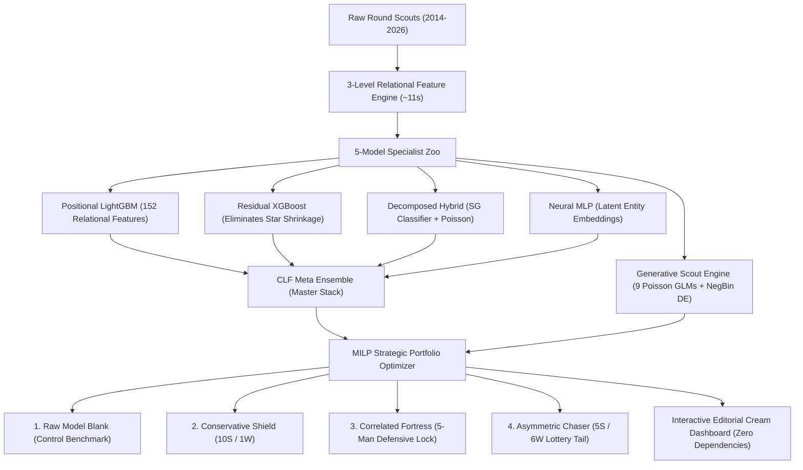

# ⚽ Cartola Legends of the Future (CLF)

[](https://www.python.org/downloads/)
[](LICENSE)
[]()

> **Autonomous Machine Learning Intelligence, Generative Poisson Physics & Strategic Portfolio Optimization for Cartola FC.**

---

## 🌟 Overview

**CLF** is an end-to-end quantitative intelligence system that transforms Cartola FC decision-making from subjective intuition into rigorous mathematical optimization. 

Built across **12 seasons of historical data (2014–2025)** and **131,660 player matches**, CLF combines a 5-model ML specialist ensemble, a generative Poisson scout simulator, and a Mixed Integer Linear Programming (MILP) portfolio solver to deliver **ready-to-play squad portfolios** with complete mathematical explainability.

---

## 🧠 System Architecture



---

## ♟️ The 4 Strategic Lineups

1. **♟️ Raw Model Blank (Unconstrained Control):** Pure points maximization without constraints or cannibalization penalties.
2. **🛡️ The Conservative Shield (10 Solids + 1 Wildcard):** Built for protecting 1st-place league leads with maximum floor consistency.
3. **🏰 The Correlated Fortress (5-Man SG Defensive Lock):** High-leverage portfolio locking all 5 defenders from a heavy clean-sheet favorite ($P(\text{SG}) \ge 38\%$).
4. **🚀 The Asymmetric Chaser (5 Solids + 6 Wildcards):** High-volatility lottery lineup designed for league chasers seeking 90th-percentile right-tail explosions.

---

## ⚡ Click-and-Go CLI Quickstart

Run inference in **~12 seconds** from a cold start:

```powershell
# Auto-detect latest cached round and predict next unplayed round
python run_inference.py

# Run for a specific season and round
python run_inference.py --season 2026 --round 35

# Optimize starting 12 with a custom bankroll budget
python run_inference.py --season 2026 --round 35 --budget 167.0

# Force zoo retraining and model re-serialization
python run_inference.py --retrain
```

---

## 📊 Live Reports & Dashboards

The interactive editorial cream dashboard is deployed via GitHub Pages:

* **[Live Dashboard (Root / Latest Round)](https://mrpatinhas.github.io/CLF/)**
* **[Season 2026 Round 35 Full Report](https://mrpatinhas.github.io/CLF/inference_2026_r35.html)**

### Key Dashboard Features:
* **Pure Plus Jakarta Sans Typography:** Balanced proportions and readable tables.
* **100% Standalone Base64 Assets:** Official Serie A club crests and logo inlined directly.
* **Sub-millisecond Universal Receipts:** Click `[🧾 Breakdown]` on any player across all tables, pitch cards, or Plotly dots to audit their exact Poisson scout arrival rates $\lambda \times \text{weights}$.
* **4-3-3 Tactical Pitch View:** Visual soccer formation with departmental subtotals (Attack, Midfield, Defense).
* **Luxury Advisory Bench:** 9 best-in-slot upgrades for bankrolls $> C\$ 135$.
* **Captaincy Decision Engine:** 3-way toggle (Mean, Ceiling P90, or Spread) with instant $1.5\times$ boost recalculation.

---

## 📁 Repository Structure

```
CLF/
├── academy/                   # Interactive educational modules & Poisson masterclass
├── data/
│   ├── models/                # Pre-trained serialized models (.joblib)
│   ├── raw/                   # Historical and 2026 round snapshots
│   └── inference_2026_r35.parquet
├── reports/
│   ├── index.html             # Standalone live entrypoint (GitHub Pages)
│   ├── inference_2026_r35.html# Round 35 full editorial dashboard
│   ├── assets/                # Club crests & CLT logo
│   └── 01_..05_*.html         # Analytical study reports (76-Round study, etc.)
├── src/
│   ├── 01_build_feature_store.py
│   ├── 02_train_and_evaluate_models.py
│   ├── 03_generate_html_suite.py
│   ├── 04_ingest_2026.py
│   ├── 05_infer_2026_round35.py
│   ├── 06_solids_vs_wildcards_study.py
│   ├── generative_specialist.py
│   ├── model_registry.py
│   ├── portfolio_optimizer.py
│   ├── report_generator.py
│   └── round_fetcher.py
├── checkpoint.md              # Complete learning log & 15 learnable pills
├── plan.md                    # Product Requirements Document & PRD
├── run_inference.py           # Click-and-go CLI tool
└── README.md
```

---

## ⚖️ License

MIT License. Designed and developed with rigor by **Thiago** & Antigravity.
